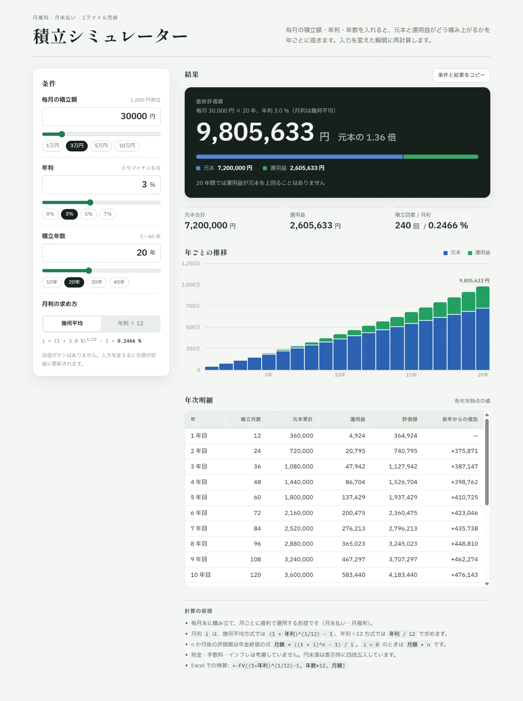

# 積立シミュレーター

毎月の積立額・年利・積立年数を入力すると、元本合計・運用益・最終評価額と年ごとの推移（表＋積み上げ棒グラフ）を即座に表示する、**1 ファイル完結**の Web アプリです。ビルド工程も外部ライブラリもありません。



## 使い方

`index.html` をブラウザで開くだけです。ローカルサーバーは不要です。

```bash
git clone https://github.com/metal-saito/tsumitate-sim.git
cd tsumitate-sim
start index.html   # Windows
open index.html    # macOS
```

- 入力を変えると即座に再計算します（送信ボタンはありません）
- 「条件と結果をコピー」で、条件と結果をテキストとしてクリップボードに入れられます
- 画面下部の「検算」セクションで、固定ケースの期待値とアプリの計算値の一致を確認できます

## 機能

| 項目 | 内容 |
|---|---|
| 入力 | 毎月の積立額（円）、年利（%）、積立年数（1〜60 年）。数値入力・スライダー・プリセットが連動 |
| 月利の求め方 | 幾何平均 `(1+r)^(1/12) − 1`（既定）／ 年利÷12 を切替可。採用中の式と月利を表示 |
| 出力 | 最終評価額、元本合計、運用益、元本に対する倍率、運用益が元本を上回る年、年次明細表 |
| グラフ | 年ごとの元本・運用益の積み上げ棒グラフ。`div` の高さのみで描画し、ホバー／フォーカスでツールチップ |
| エッジケース | 年利 0 → 元本と一致。年利マイナス → 損失を斜線で表示。入力が空・範囲外 → 結果を隠して案内を表示 |
| テーマ | OS 設定に追従するライト／ダーク対応。`data-theme="light|dark"` で強制も可 |
| レスポンシブ | 約 400px 幅でも横スクロールなし。表のみ自身のコンテナ内でスクロール |

## 計算仕様

毎月末に積み立て、月ごとに複利で運用する前提（月末払い・月複利）です。

| 記号 | 意味 |
|---|---|
| `P` | 毎月の積立額 |
| `r` | 年利（小数。3 % なら 0.03） |
| `i` | 月利 |
| `n` | 積立月数（= 年数 × 12） |

```text
月利      i  = (1 + r)^(1/12) − 1        ... 幾何平均方式（既定）
             = r / 12                     ... 年利÷12方式（切替時）
評価額    FV = P × ((1 + i)^n − 1) / i    ... 年金終価
             = P × n                       ... i = 0 のとき（0 除算を回避）
元本累計     = P × n
運用益       = FV − 元本累計
```

年次明細は各年末（12 か月ごと）の時点で上式を評価しています。円未満は表示時に四捨五入し、内部は浮動小数のまま持ちます。税金・手数料・インフレは考慮していません。

## 検算

「動いた」は「正しい」ではないため、配布前に次のケースで期待値と一致することを確認しています。期待値は Excel の `FV` 関数と、式を使わない月次ループ（毎月 `P` を足して `(1+i)` を掛ける）の両方で算出しました。

| 月額 | 年利 | 年数 | 期待される最終評価額 | Excel |
|---|---|---|---|---|
| 10,000 円 | 0 % | 10 年 | 1,200,000 円 | `=-FV(0, 120, 10000)` |
| 30,000 円 | 3 % | 20 年 | 9,805,633 円 | `=-FV((1+0.03)^(1/12)-1, 240, 30000)` |
| 50,000 円 | 5 % | 30 年 | 40,768,795 円 | `=-FV((1+0.05)^(1/12)-1, 360, 50000)` |

2 行目のケースはアプリ内の「検算」セクションに組み込んであり、起動するたびに一致判定が走ります。

## コード構成

```text
tsumitate-sim/
├── index.html      # アプリ本体（HTML / CSS / JS をすべて含む）
├── CLAUDE.md       # 開発方針・計算ルール・検算ケース（Claude Code が毎回読み込む指示書）
├── README.md
└── docs/
    └── screenshot.png
```

`index.html` の内部は次の順で並んでいます。

| ブロック | 内容 |
|---|---|
| `<style>` 冒頭の `:root` | 色・フォントのデザイントークン。ライト値を `:root`、ダーク値を `prefers-color-scheme` と `[data-theme="dark"]` の両方で再定義 |
| HTML | 左に条件パネル（`aside.panel`）、右に結果（`section.results`）。結果は `#out`（通常表示）と `#empty`（未入力時）を切り替え |
| JS: 計算ロジック | `monthlyRate` / `futureValue` / `simulate`。UI に依存しない純粋関数で、根拠となる式をコメントに記載 |
| JS: 整形 | `fmtYen`（3 桁区切り、負値は U+2212）、`fmtShort`（軸ラベルの万・億表記）、`niceStep`（きりのよい目盛り） |
| JS: 描画 | `render` → `renderChart` / `renderTable` / `renderVerify`。入力の検証は `readInputs` |
| JS: 入力同期 | 数値入力 ⇄ スライダー ⇄ プリセットチップの連動、月利方式の切替、コピー |

グラフの色（元本 `#2C62B4` / 運用益 `#22A061`、ダークは `#5586D6` / `#38AB6B`）は、OKLab ΔE による色覚多様性チェックを通した値です。損失はステータス色（赤系）＋斜線パターンで、色だけに依存しない表現にしています。

## 開発するときの約束

[CLAUDE.md](CLAUDE.md) が正本です。要点だけ抜粋します。

- `index.html` 1 ファイルを維持する。ビルド不要、外部ライブラリ禁止（Web フォントはフォールバック必須）
- UI・コメントは日本語。金額は円で 3 桁区切り、利率は小数 1 桁
- 計算式を変えたら、そのコードの直上のコメントと README の「計算仕様」、検算ケースを一緒に更新する
- 色・フォント・余白は `:root` のトークンに集約し、各所で直書きしない
- 変更後は、ライト／ダーク両テーマ、スマホ幅、年利 0・マイナス、空入力の 5 点を必ず目視する

スクリプト部分だけ構文チェックしたい場合:

```bash
sed -n '/^<script>$/,/^<\/script>$/p' index.html | sed '1d;$d' > /tmp/app.js && node --check /tmp/app.js
```

## 動作環境

モダンブラウザ（Chrome / Edge 105+、Safari 15.4+、Firefox 121+）。CSS の `:has()` と `max()` を使っています。Web フォント（Shippori Mincho / IBM Plex Sans JP / IBM Plex Mono）は Google Fonts から読み込みますが、オフラインでは OS 標準の明朝・ゴシックにフォールバックします。
